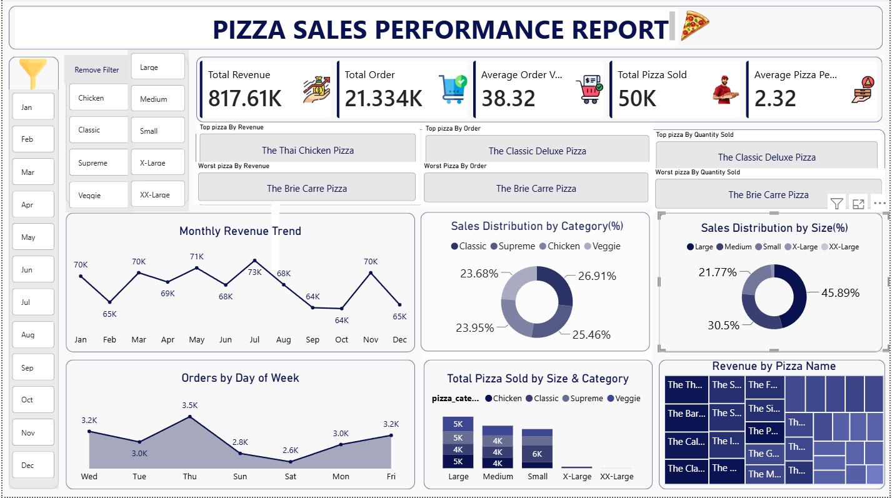

# Pizza-Sales-PowerBI-Dashboard
An interactive Power BI dashboard analyzing $817k in retail sales performance and operational trends.
# Pizza Sales Performance & Operations Dashboard

## 📊 Project Overview
This end-to-end business intelligence project analyzes over 21,000 retail orders to deliver key operational insights and revenue optimizations for a pizza restaurant chain. 

### 📷 Dashboard Preview

## 🎯 Key Insights & Business Impact
* **Revenue Peak:** Identified Thursday through Friday as peak traffic windows, driving over 30% of total weekly order volume.
* **Product Optimization:** Isolated the "Brie Carre Pizza" as the lowest revenue driver, providing a data-driven recommendation to stakeholders for menu refinement.
* **Volume Drivers:** Discovered that Large pizzas account for 45.8% of total sales, indicating a strong consumer preference for family-sized portions.

## 🛠️ Tech Stack & Skills Used
* **Power BI Desktop:** Dashboard design, layout architecture, and user experience.
* **Power Query:** Data cleaning, removing null values, changing data types, and text standardization.
* **DAX (Data Analysis Expressions):** Created custom measures for Total Revenue, Average Order Value, and Total Pizzas Sold.

## 📁 Repository Structure
* `PIZZA SALES DASHBOARD.pbix`: The core Power BI report file.
* `pizza_sales.csv`: Raw transactional sales data used for the analysis.
